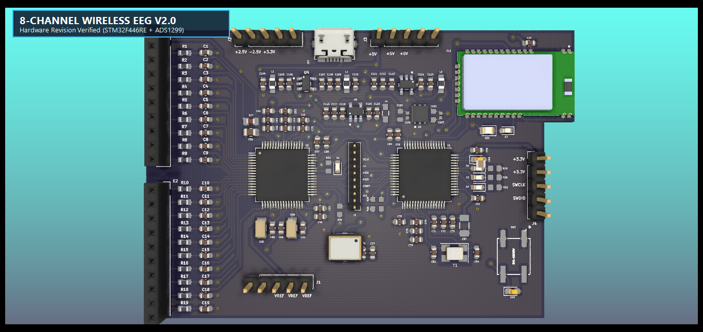

# 8 Channel Wireless EEG

**Installation of Kicad on Ubuntu**

```bash
sudo add-apt-repository --yes ppa:kicad/kicad-5.1-releases

sudo apt update

sudo apt install --install-recommends kicad
```

**After installation;**

```bash
cd ~/Desktop

git clone "https://github.com/aliozcanunal/8-Channel-Wireless-EEG"

kicad eeg.pro
```


## V2.0 Donanım Revizyonu ve Hata Düzeltmeleri

Bu sürümde (V2.0) tespit edilen kritik şema ve PCB tasarım hataları düzeltilmiştir:
1. **STM32F446RE Besleme Kısa Devresi Giderildi:** Pin 12 (`VSSA`) ve Pin 63 (`VSS`) pinlerinin `+3.3V`'a olan bağlantısı kesilerek `GND` referansına bağlandı.
2. **ADS1299 EEG Ortak Referans Hattı (SRB2):** Pin 18 (`SRB2`) üzerindeki `NoConn` kaldırılarak `/SRB2` ağı bağlandı ve PCB yolu çizildi.
3. **ADS1299 BIAS Kararlılığı:** `C1` kapasitörü `10µF` yerine `1nF` yapılarak BIAS amplifikatör osilasyonu önlendi.
4. **RN4678 Bluetooth Modülü:** `SW_BTN` (Pin 5) ve `WAKEUP` (Pin 9) kontrol pinleri aktif hale getirildi; anten altındaki bakır dolgular temizlenip `Keep-Out Zone` tanımlandı.
5. **STM32 VCAP_1 Regülatör Kapasitörü:** `C42` tantal yerine 4.7µF düşük ESR'li seramik (MLCC 0603) olarak güncellendi.
6. **Kristal Yük Kapasitörleri & Ayak Bağlantısı:** `Y1` 4-pin kristal bağlantıları ve kılıf uyumlulukları düzeltildi.
7. **Edge.Cuts Sınır Düzeltmesi:** PCB sınırındaki açık köşe hatası giderildi.

> Detaylı teknik açıklama için [REVIZYON_V2.md](REVIZYON_V2.md) dosyasını inceleyebilirsiniz.
