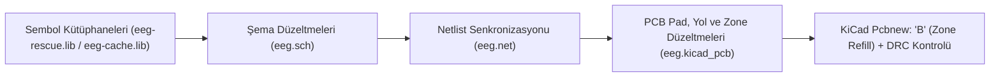

# 8-Kanallı Kablosuz EEG — V2.0 Donanım Revizyon Rehberi

Bu rehber, mevcut BOM (`STM32F446RE` + `ADS1299` + `RN4678` + `TPS60403` / `TPS73225` / `TPS72325` / `LD39050PU33R`) korunarak [`eeg.sch`](file:///C:/Users/woof/.gemini/antigravity/scratch/8-Channel-Wireless-EEG/eeg.sch), [`eeg-rescue.lib`](file:///C:/Users/woof/.gemini/antigravity/scratch/8-Channel-Wireless-EEG/eeg-rescue.lib), [`eeg-cache.lib`](file:///C:/Users/woof/.gemini/antigravity/scratch/8-Channel-Wireless-EEG/eeg-cache.lib), [`eeg.net`](file:///C:/Users/woof/.gemini/antigravity/scratch/8-Channel-Wireless-EEG/eeg.net) ve [`eeg.kicad_pcb`](file:///C:/Users/woof/.gemini/antigravity/scratch/8-Channel-Wireless-EEG/eeg.kicad_pcb) dosyalarına doğrudan uygulanan düzeltmeleri ve üretim (Gerber) öncesi son kontrol adımlarını içerir.

> [!IMPORTANT]
> Proje dosyaları çalışma alanınızda [`C:/Users/woof/.gemini/antigravity/scratch/8-Channel-Wireless-EEG`](file:///C:/Users/woof/.gemini/antigravity/scratch/8-Channel-Wireless-EEG) dizinine kaydedilmiştir. KiCad `Pcbnew` içinde kartı açtığınızda bakır dolgu alanlarını (`GNDA` zone) yeni yollarla ve anten yasaklı bölgesiyle (`Keep-Out Zone`) senkronize etmek için **`B`** tuşuna basarak dolguları yenileyin (**Refill All Zones**) ve ardından **DRC** çalıştırın.

---

## 1. Revizyon Mimarisi ve Uygulanan Düzeltme Akışı

---

## 2. Dosya Bazlı Uygulanan Kritik Düzeltmeler

### 2.1. `STM32F446RE` (`U1`) Besleme Kısa Devresinin Giderilmesi (`+3.3V` – `GND`)
- **Sorun:** `U1` (`STM32F446RE`, LQFP-64) üzerinde **Pin 12 (`VSSA/VREF-`)** ve **Pin 63 (`VSS`)**, şemada ve PCB'de doğrudan `+3.3V` (`net 31`) hattına bağlanmıştı.
- **Uygulanan Çözüm:**
  - [`eeg.sch`](file:///C:/Users/woof/.gemini/antigravity/scratch/8-Channel-Wireless-EEG/eeg.sch#L1860-L1885): Pin 12 (`12700, 8300`) ve Pin 63 (`13200, 6800`) üzerindeki `+3.3V` bağlantıları koparılarak `GNDD` referansına bağlandı.
  - [`eeg.kicad_pcb`](file:///C:/Users/woof/.gemini/antigravity/scratch/8-Channel-Wireless-EEG/eeg.kicad_pcb#L4318-L4430): `U1` Pad 12 ve Pad 63 net tanımları `(net 129 GNDA)` olarak güncellendi.
  - [`eeg.kicad_pcb`](file:///C:/Users/woof/.gemini/antigravity/scratch/8-Channel-Wireless-EEG/eeg.kicad_pcb#L6680-L6750): Pad 12 ile Pad 13 (`VDDA`) ve Pad 63 ile Pad 64 (`VDD`) arasındaki kısa devre bakır segmentleri kaldırıldı; `+3V3` besleme yolu doğrudan Pad 13 (`93.2455, 63.195`) üzerine yönlendirildi ve Pad 12 / Pad 63 için `GNDA` bağlantıları eklendi.

### 2.2. `STM32F446RE` `VCAP_1` (`C42`) Regülatör Kapasitörü Güncellemesi
- **Sorun:** LQFP-64 kılıflı `STM32F446RE` tek bir `VCAP_1` (Pin 31) pinine sahiptir ve ST veri sayfasına göre **4.7 µF düşük ESR'li seramik (MLCC)** kapasitör gerektirir (mevcut tasarımda `2.2uF` tantal seçilmişti).
- **Uygulanan Çözüm:**
  - [`eeg.sch`](file:///C:/Users/woof/.gemini/antigravity/scratch/8-Channel-Wireless-EEG/eeg.sch#L948-L957), [`eeg.net`](file:///C:/Users/woof/.gemini/antigravity/scratch/8-Channel-Wireless-EEG/eeg.net#L329-L335) ve [`eeg.kicad_pcb`](file:///C:/Users/woof/.gemini/antigravity/scratch/8-Channel-Wireless-EEG/eeg.kicad_pcb#L5883-L5894) dosyalarında `C42` değeri `4.7uF` ve kılıfı `Capacitor_SMD:C_0603_1608Metric` (düşük ESR MLCC) olarak güncellendi.

### 2.3. `ADS1299` (`U2`) Sembol Pin İsimleri, `SRB2` Ortak Referans Hattı ve `BIAS` Kararlılığı
- **Sorun:**
  1. `ADS1299` sembolünde `ADS1298` EKG çipinden kalan pin isimleri (`TESTP_PACE_OUT1`, `RLDINV` vb.) bulunuyordu.
  2. Konnektör tarafında filtrelenen `SRB2` ortak EEG referans hattı, `U2` Pin 18 (`SRB2`) üzerinde `NoConn` (`X`) ile açık bırakılmıştı.
  3. `BIASOUT` (Pin 63) ve `BIASINV` (Pin 61) arasındaki geri besleme kapasitörü `C1 = 10uF` seçildiği için BIAS op-amp'ı kararsızlığa/osilasyona giriyordu.
- **Uygulanan Çözüm:**
  - [`eeg-rescue.lib`](file:///C:/Users/woof/.gemini/antigravity/scratch/8-Channel-Wireless-EEG/eeg-rescue.lib#L26-L72) ve [`eeg-cache.lib`](file:///C:/Users/woof/.gemini/antigravity/scratch/8-Channel-Wireless-EEG/eeg-cache.lib#L140-L186): Pin 17 = `SRB1`, Pin 18 = `SRB2`, Pin 60 = `BIASREF`, Pin 61 = `BIASINV`, Pin 62 = `BIASIN`, Pin 63 = `BIASOUT` olarak düzeltildi.
  - [`eeg.sch`](file:///C:/Users/woof/.gemini/antigravity/scratch/8-Channel-Wireless-EEG/eeg.sch#L1885-L1895) ve [`eeg.kicad_pcb`](file:///C:/Users/woof/.gemini/antigravity/scratch/8-Channel-Wireless-EEG/eeg.kicad_pcb#L6921-L6930): `U2` Pin 18 (`SRB2`) üzerindeki `NoConn` kaldırılarak `/SRB2` (`net 43`) etiketi bağlandı ve PCB'de `C19`/`R23` (`48.641, 83.0046`) noktasından `U2` Pad 18 (`60.75, 63.1825`) pinine bakır yol (`F.Cu`) çekildi.
  - [`eeg.sch`](file:///C:/Users/woof/.gemini/antigravity/scratch/8-Channel-Wireless-EEG/eeg.sch#L450-L459) ve [`eeg.kicad_pcb`](file:///C:/Users/woof/.gemini/antigravity/scratch/8-Channel-Wireless-EEG/eeg.kicad_pcb#L2970-L2975): `C1` kapasitörü `10uF` yerine **`1nF`** (`10 kΩ` `R25` ile ~16 kHz kutup frekansı) olarak güncellendi.

### 2.4. `Y1` (`16 MHz` SMD Kristal) Pin Eşleşmesi ve Yük Kapasitörleri (`C80`, `C81`)
- **Sorun:** Şemada 2 pinli kristal sembolü (`Device:Crystal`) kullanılırken PCB'de 4 pad'li `Crystal_SMD_3225-4Pin` kılıfı kullanılmış; bu yüzden `OSC_OUT` (`net 88`) kristalin çıkış pini olan **Pad 3** yerine toprak kılıf pini olan **Pad 2**'ye bağlanmıştı ve Pad 3/4 boşta (`net 0`) kalmıştı. Ayrıca `9pF` yük kapasitörleri (`C80`, `C81`) şemada `1206` olarak tanımlanmıştı.
- **Uygulanan Çözüm:**
  - [`eeg.kicad_pcb`](file:///C:/Users/woof/.gemini/antigravity/scratch/8-Channel-Wireless-EEG/eeg.kicad_pcb#L6215-L6223): `Y1` Pad 1 = `net 87` (`OSC_IN`), Pad 2 = `net 129` (`GNDA`), Pad 3 = `net 88` (`OSC_OUT`), Pad 4 = `net 129` (`GNDA`) olarak düzeltildi.
  - [`eeg.kicad_pcb`](file:///C:/Users/woof/.gemini/antigravity/scratch/8-Channel-Wireless-EEG/eeg.kicad_pcb#L7240-L7248): `C81` Pad 1'den (`92.75, 71.475`) `Y1` Pad 3'e (`95.05, 73.45`) bakır yol yönlendirildi; Pad 2 ve Pad 4'e `GNDA` bağlantıları eklendi.
  - [`eeg.sch`](file:///C:/Users/woof/.gemini/antigravity/scratch/8-Channel-Wireless-EEG/eeg.sch#L890-L915): `C80` ve `C81` kılıfları PCB ile uyumlu olacak şekilde `Capacitor_SMD:C_0603_1608Metric` yapıldı.

### 2.5. `RN4678` (`U12`) Bluetooth Modülü Kontrol Pinleri ve Anten Keep-Out Bölgesi
- **Sorun:**
  1. `U12` üzerinde **Pin 5 (`SW_BTN`)** ve **Pin 9 (`WAKEUP`)** boşta (`NoConn`) bırakıldığı için modül kapalı/uyku modunda kalıyordu.
  2. `U12` seramik anteninin (`X: 112.15..119.54 mm, Y: 34.8..45.5 mm`) tam altında `F.Cu` ve `B.Cu` katmanlarında `GNDA` bakır alanı ve `118.525 mm` hattında dikey bir `GNDA` yolu geçiyordu; mevcut `Keep-Out Zone` ise `copperpour allowed` olarak ayarlanmıştı.
- **Uygulanan Çözüm:**
  - [`eeg.sch`](file:///C:/Users/woof/.gemini/antigravity/scratch/8-Channel-Wireless-EEG/eeg.sch#L1835-L1865) ve [`eeg.kicad_pcb`](file:///C:/Users/woof/.gemini/antigravity/scratch/8-Channel-Wireless-EEG/eeg.kicad_pcb#L6705-L6710): `U12` Pin 5 (`SW_BTN`) `+3.3V` (`net 31`) hattına, Pin 9 (`WAKEUP`) ise `INT3V3` (`net 148`, `R31` üzerinden pull-high) hattına bağlandı ve PCB segmentleri eklendi.
  - [`eeg.kicad_pcb`](file:///C:/Users/woof/.gemini/antigravity/scratch/8-Channel-Wireless-EEG/eeg.kicad_pcb#L7635-L7656): Anten altından geçen dikey `GNDA` yolu kaldırıldı, `Keep-Out Zone` her iki katmanı (`F&B.Cu`) ve bakır dolguları (`copperpour not_allowed`) kapsayacak şekilde `(xy 119.542 45.5) (xy 112.15 45.5) (xy 112.15 34.8) (xy 119.542 34.8)` koordinatlarına genişletildi.

### 2.6. Sembol/Kılıf Uyuşmazlıkları ve `Edge.Cuts` Sınır Düzeltmesi
- **Sorun:**
  - `R31` (`270 Ω` direnç) şemada `LED_0805` kılıfına atanmıştı.
  - `R20`, `R21`, `R22` LED akım sınırlama dirençlerinin değeri `R_Small` olarak bırakılmıştı.
  - `C62` (`100uF` bulk kapasitör) şemada `0603` kılıfında görünüyordu.
  - `Edge.Cuts` katmanında `(113.8, 47.375)` ile `(113.792, 47.375)` ve `(119.55, 47.375)` ile `(119.542, 47.375)` arasında `8 µm`'lik açık köşe hatası vardı.
- **Uygulanan Çözüm:**
  - [`eeg.sch`](file:///C:/Users/woof/.gemini/antigravity/scratch/8-Channel-Wireless-EEG/eeg.sch#L1025-L1035): `R31` kılıfı `Resistor_SMD:R_0805_2012Metric`, `C62` kılıfı `TCA1C106M8R:RESC3216X65N` (1206), `R20`–`R22` değerleri `270` (`270 Ω`) olarak düzeltildi.
  - [`eeg.kicad_pcb`](file:///C:/Users/woof/.gemini/antigravity/scratch/8-Channel-Wireless-EEG/eeg.kicad_pcb#L6632-L6640): `Edge.Cuts` köşe koordinatları tam kapalı (`watertight`) poligon olacak şekilde `113.792` ve `119.542` olarak hizalandı.

---

## 3. Özet Değişiklik Tablosu

| Bileşen / Ağ | Tespit Edilen Hata | Uygulanan Revizyon | Güncellenen Dosyalar |
| :--- | :--- | :--- | :--- |
| **`U1` (`STM32F446RE`) Pin 12 & 63** | `VSSA/VREF-` ve `VSS` pinleri `+3.3V`'a kısa devre | `GNDD`/`GNDA` hattına bağlandı, kısa devre yollar ayrıldı | `eeg.sch`, `eeg.net`, `eeg.kicad_pcb` |
| **`C42` (`VCAP_1`)** | `2.2uF` Tantal kapasitör (kararsız çekirdek regülatörü) | `4.7uF` `0603` düşük ESR MLCC yapıldı | `eeg.sch`, `eeg.net`, `eeg.kicad_pcb` |
| **`U2` (`ADS1299`) Pin 18 (`SRB2`)** | `NoConn` (`X`) nedeniyle elektrot referansı kopuk | `/SRB2` (`net 43`) bağlandı ve PCB yolu çizildi | `eeg-rescue.lib`, `eeg.sch`, `eeg.net`, `eeg.kicad_pcb` |
| **`C1` (`BIASOUT` – `BIASINV`)** | `10uF` geri besleme kapasitörü (op-amp osilasyonu) | `1nF` (`0603`) olarak değiştirildi | `eeg.sch`, `eeg.net`, `eeg.kicad_pcb` |
| **`Y1` (`16 MHz` SMD Kristal)** | 2-pin şema / 4-pin PCB uyuşmazlığı (`OSC_OUT` Pad 2'de) | `OSC_OUT` Pad 3'e yönlendirildi, Pad 2 ve 4 `GNDA`'ya bağlandı | `eeg.kicad_pcb` |
| **`U12` (`RN4678`) Pin 5 & 9** | `SW_BTN` ve `WAKEUP` boşta (modül uyanmıyor) | Pin 5 `+3.3V`'a, Pin 9 `INT3V3`'e bağlandı | `eeg.sch`, `eeg.net`, `eeg.kicad_pcb` |
| **`U12` Anten Bölgesi** | Anten altında `GNDA` bakır alanı ve yolu | `F&B.Cu` `copperpour not_allowed` Keep-Out Zone tanımlandı | `eeg.kicad_pcb` |
| **`R31`, `R20`–`R22`, `C62`, `C80`–`C81`** | Yanlış kılıf (`LED_0805`, `0603` 100uF) ve eksik değerler | Doğru SMD kılıfları ve `270 Ω` değerleri atandı | `eeg.sch`, `eeg.net`, `eeg.kicad_pcb` |
| **`Edge.Cuts`** | Sağ üst çıkıntıda `0.008 mm` açık köşe | Koordinatlar `113.792` ve `119.542` ile tam kapatıldı | `eeg.kicad_pcb` |

---

## 4. Üretim Öncesi Son Adımlar ve İleriye Dönük (V2.1+) Tavsiyeler

> [!TIP]
> **KiCad İçinde Yapılması Gereken Tek Tuş İşlemi:**
> `eeg.kicad_pcb` dosyasını KiCad `Pcbnew` ile açtıktan sonra klavyeden **`B`** tuşuna basın. Bu işlem, eklenen/düzenlenen yolların etrafındaki `GNDA` bakır dolgularını (`filled_polygon`) otomatik olarak yeniden hesaplayacak ve `RN4678` anteninin altındaki bakır dolguyu yeni `Keep-Out Zone` sınırlarına göre tamamen boşaltacaktır.

1. **BOM / Montaj Notu (`L1`, `L2`, `L3`):** Şemada `+3.3V` ile `AVDD` ve `+5VA` arasında yer alan `L1`, `L2`, `L3` (`100nH`, `0603`) elemanlarının yerine montaj (PCBA) sırasında aynı `0603` kılıfında **`600 Ω @ 100 MHz` Ferrite Bead** (ör. Murata `BLM18PG601SN1D`) dizilmesi, `TPS60403` anahtarlama gürültüsünü rezonans oluşturmadan sönümleyecektir.
2. **Medikal Güvenlik (IEC 60601-1):** Kart üzerinde batarya/güç girişi (`J2`) doğrudan regülatörlere bağlıdır. Kafa derisine elektrot bağlıyken cihazın **yalnızca batarya ile** çalıştırılması, şebekeye bağlı bir adaptör/USB kaynağına doğrudan bağlanmaması gerekir.
